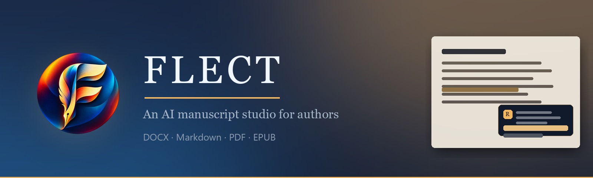
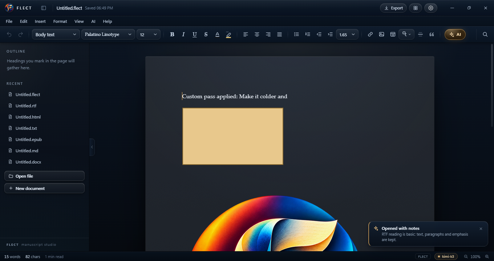
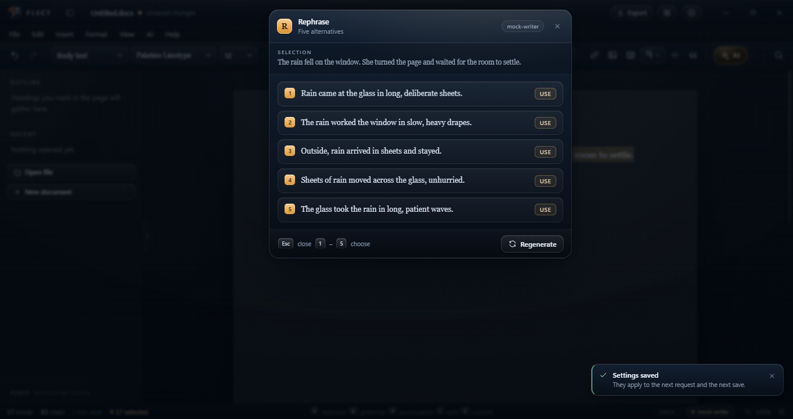
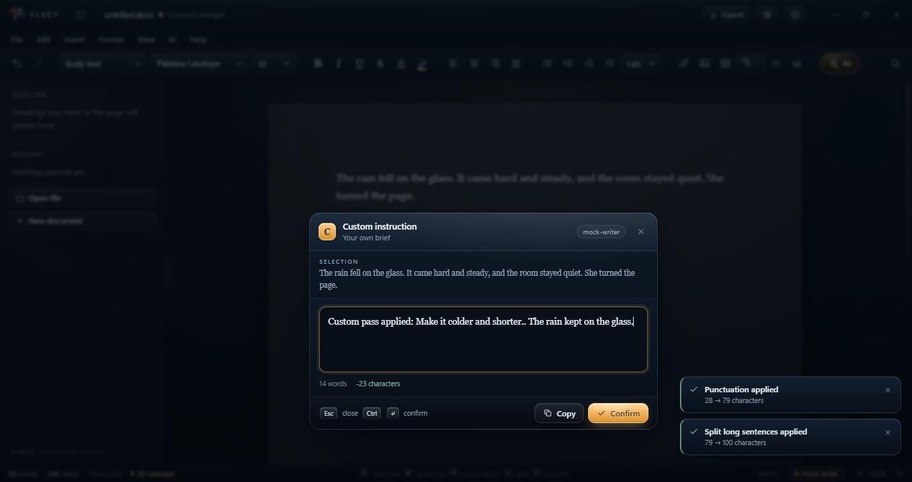
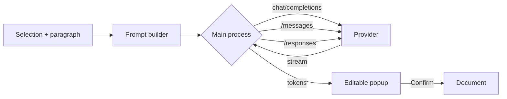

<div align="center">
  
</div>

<div align="center">

[](#install)
[](https://github.com/XNtriCT/flect/releases)
[](https://github.com/XNtriCT/flect/actions/workflows/ci.yml)
[](LICENSE)

[](package.json)
[](package.json)
[](package.json)
[](package.json)

</div>

**FLECT** is a desktop word processor for people writing books. It opens the
formats manuscripts actually arrive in, renders the page the way a printed book
looks, and puts five revision tools behind single keys. Each one streams a
suggestion you can edit by hand, and none of them touch the manuscript until you
press Confirm.

Your API key is encrypted on your machine by the OS credential store. The only
thing that leaves the computer is the text you explicitly send.



## Five keys, no menus

Select a sentence, press a key. That is the whole interface.

| Key | Action | What comes back |
|:---:|--------|-----------------|
| **R** | Rephrase | Five distinct alternatives in a floating list. Click one, or press `1`–`5`. |
| **G** | Grammar and spelling | Corrections that keep the voice intact, in an editable popup with Confirm. |
| **P** | Punctuation | Dashes, colons and semicolons turned into prose, awkward constructions rebuilt. |
| **L** | Sentence splitting | Long comma-choked sentences split in two without flattening the rhythm. |
| **C** | Custom instruction | A prompt box beside the selection; the answer streams into a canvas you can edit. |

Right-click offers the same five actions, alongside cut, copy, paste and spelling
suggestions. Every suggestion is text in a box until you confirm it, and undo is
unlimited. Turning the bare keys off in Settings → Editor switches them to
`Alt`+letter, so nothing steals a keystroke a writer expects.

<div align="center">
  
  
</div>

## What it does

**Editing.** Headings, lists, quotes, tables, links, images, inline shapes and
text boxes. Font, size, weight, colour, highlight, alignment, indents, line
spacing. Find and replace across the document, unlimited undo, autosave, and
crash recovery.

**Page view.** A4 or US Letter, adjustable margins, ivory or white paper, real
page boundaries, and a zen mode that hides everything but the words.

**AI layer.** Any OpenAI-compatible endpoint: OpenAI, OpenRouter, Groq, DeepSeek,
Together, Ollama, LM Studio, vLLM, OpenCode Go. Paste a base URL, fetch the model
list, pick a model. All HTTP happens in the main process, so the key never enters
the renderer and there is no CORS surface.

**Voice protection.** The shipped prompts forbid em dashes, en dashes and the
stock constructions of machine-written prose. If a model returns them anyway, a
deterministic sweep removes them before the text reaches the page. Every prompt
is editable per key in Settings → Prompts.

**Files.** Open and save in place, or export a copy without touching the
original.

| Format | Open | Save in place | Export copy |
|--------|:----:|:-------------:|:-----------:|
| DOCX / DOCM / DOTX | ✅ | ✅ | ✅ |
| Markdown | ✅ | ✅ | ✅ |
| Plain text | ✅ | ✅ | ✅ |
| HTML | ✅ | ✅ | ✅ |
| RTF | ✅ | ✅ | ✅ |
| FLECT (`.flect`) | ✅ | ✅ | ✅ |
| PDF | — | — | ✅ |
| EPUB 3 | — | — | ✅ |

DOCX and RTF are regenerated from the editor model, which keeps text, headings,
emphasis, colour, alignment, lists, tables, images and page numbers. Word
features outside that set (tracked changes, fields, macros, footnotes) do not
survive a round trip.

## Install

Download **`FLECT-1.1.0-Setup.exe`** from [Releases](https://github.com/XNtriCT/flect/releases)
and run it. The installer is per-user, installs to `%LOCALAPPDATA%\Programs\FLECT`,
and needs no administrator rights. Requires 64-bit Windows 10 or 11.

The binary is not code-signed yet, so SmartScreen shows a one-time "unrecognised
app" prompt: choose **More info → Run anyway**. Each release publishes the
SHA-256 of its installer so you can verify the file you downloaded.

## Build from source

```bash
git clone https://github.com/XNtriCT/flect.git
cd flect
npm install

npm run dev     # Vite dev server + Electron with hot reload
npm run build   # production renderer bundle into dist/
npm run dist    # bundle + NSIS installer into release/
```

Node 20 or newer. The first `npm install` downloads the Electron runtime
(~90 MB) and takes a minute on a cold cache.

## Architecture

FLECT is a three-process Electron application. The renderer owns the document and
never touches the disk; the main process owns files, settings and every network
call; a narrow preload bridge exposes only named operations.

```
electron/
  main.js          window lifecycle, file IO, settings, AI transport, menus
  preload.js       contextBridge surface (window.flect)
  ai-shapes.js     provider protocol routing
src/
  App.jsx          document state, commands, keyboard map
  editor/          TipTap extensions, shape node, find and replace
  components/      title bar, toolbar, AI popup, settings, navigator
  lib/
    prompts.js     system prompts, task templates, parsing
    formats.js     open/save/export registry
    export/        DOCX, EPUB, Markdown, RTF, HTML, text serializers
  styles/app.css   the visual system
```



Context is assembled before the request: the selection, its enclosing paragraph,
and the document's opening for tone. Nothing is written to the document until a
confirmation event arrives from the renderer.

## Configuration

Settings live in `%APPDATA%\FLECT\settings.json`. The app writes them; you rarely
need to open the file. On Windows the API key is sealed with the credential store
through Electron's `safeStorage` and never written in plain text.

| Setting | Where | Default |
|---------|-------|---------|
| Base URL | Settings → AI | `https://api.openai.com/v1` |
| API key | Settings → AI | empty, encrypted at rest |
| Model | Settings → AI | fetched from the endpoint |
| Wire protocol | Settings → AI | auto-detect per model |
| Page size, margins, paper | Settings → Editor | A4, 1 inch, ivory |
| Typeface, size, leading | Settings → Editor | Palatino, 12 pt, 1.65 |
| AI keys on bare letters | Settings → Editor | on (`Alt`+letter when off) |
| Prompt overrides | Settings → Prompts | shipped prompts |

### OpenCode Go

Use base URL `https://opencode.ai/zen/go/v1`. FLECT speaks all three shapes that
service exposes and picks the right one per model:

| Shape | Endpoint | Models |
|-------|----------|--------|
| Anthropic messages | `/messages` | MiniMax M3 / M2.7, Qwen3.8 Max / Flash, Qwen3.7 Plus |
| OpenAI responses | `/responses` | Grok 4.7 / 4.6, GPT 6 Luna, GPT 5.6 Luna, Muse Spark |
| OpenAI chat | `/chat/completions` | GLM, Kimi, LongCat, DeepSeek, MiMo, Hy, Space Bunny |

Every request carries a stable `x-opencode-session` id and a `FLECT/<version>`
user agent, which is what the service needs to route and cache. Auto-detect
follows the table above; any shape can also be forced by hand.

Prompt overrides are stored as a JSON object keyed by action, each with `system`
and `task`. `{{selection}}`, `{{context}}` and `{{instruction}}` are substituted
before the request is built; if a task prompt omits `{{selection}}`, the
selection is appended so a request can never go out empty.

## Quality gates

| Suite | Command | Covers |
|-------|---------|--------|
| Unit | `npm test` | prompt building, alternative parsing, dash sweep, protocol routing, format registry |
| Static | `npm run check:static` | packaging, runtime dependencies, bundle base path, routing table |
| End-to-end | `npm run test:e2e` | 53 checks in a real Electron window against a mock provider |
| Artifacts | `npm run test:artifacts` | opens every exported DOCX, EPUB, PDF, Markdown, RTF, HTML and FLECT file and inspects its structure |

The end-to-end harness boots the real Electron binary, points it at a mock
OpenAI-compatible streaming server, drives the genuine UI with Puppeteer, and
writes every export to `.e2e/files/` for inspection. Native dialogs are replaced
with deterministic paths only when `FLECT_TEST_DIR` is set. It needs an
interactive desktop session, so it runs locally; CI covers unit, build and static
checks on `windows-latest`.

## Known limits

- The installer is not code-signed, so SmartScreen warns once on first run.
- One document per window; opening a file replaces the current page.
- RTF reading is basic: paragraphs, emphasis, quotes.
- Markdown export inlines images under ~90 KB; larger ones become a comment
  rather than bloating the file.
- If a provider answers with no prose at all (reasoning models can spend the
  whole budget thinking), FLECT retries once with a larger budget, then reports
  the shape, model and byte count it received instead of a bare "empty answer".

## Roadmap

- [x] Rich-text editor with page view and navigator
- [x] Five AI revision actions with editable suggestions
- [x] Provider-agnostic AI settings with model discovery
- [x] Eight export formats and six open formats
- [x] Editable prompts, right-click editing, window snapping
- [ ] Code signing so SmartScreen stays quiet
- [ ] Multiple documents in tabs
- [ ] DOCX round-trip fidelity: styles, footnotes, section breaks
- [ ] Track changes and margin comments
- [ ] macOS and Linux builds

## Contributing

Bug reports and pull requests are welcome. Read [CONTRIBUTING.md](CONTRIBUTING.md)
first: it covers the branch model, the checks a change has to pass, and the house
style for the prompt library. Security issues go through
[SECURITY.md](SECURITY.md), never the public issue tracker.

## License

[MIT](LICENSE) © 2026 XNtriCT.

## Acknowledgements

Format coverage follows the [ONLYOFFICE document-formats](https://github.com/ONLYOFFICE/document-formats)
matrix, the clearest public statement of what a word processor is expected to
open. Editing is built on [TipTap](https://tiptap.dev) and ProseMirror; packaging
on Electron and electron-builder.
